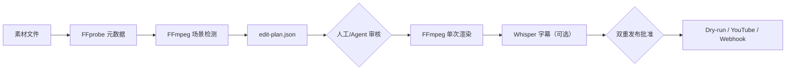

# VideoForge Agent

[](https://github.com/lionelandrcuccitini-droid/videoforge-agent/actions/workflows/ci.yml)
[](https://www.python.org/)
[](LICENSE)

VideoForge Agent 是一个 **FFmpeg-first、可审阅、可恢复** 的自动视频制作流水线。它能分析多段素材、检测镜头、生成剪辑决策清单（EDL）、统一画幅并渲染、用 Whisper 生成字幕，最后通过安全门槛发布到 YouTube 或自定义 Webhook。

> 项目处于 alpha 阶段。请只处理你有权使用的素材，并在公开发布前人工检查画面、字幕、音乐授权和平台政策。

## 为什么是这个架构

- **声明式剪辑计划**：先生成 `edit-plan.json`，人或上层 LLM 可以审阅、重排、修改，再交给确定性的渲染器。
- **FFmpeg 直接渲染**：避免逐帧搬运带来的额外开销；一个 filter graph 完成裁切、缩放、补静音和拼接。
- **可恢复阶段**：分析结果、场景列表、剪辑计划和字幕均持久化；中断后默认复用已有产物。
- **发布双重批准**：配置中的 `publishing.enabled: true` 之外，还必须传 `--approve-publish`；默认适配器只写 dry-run 清单。
- **模型可选**：基础剪辑只需要 FFmpeg；本地字幕才安装 `faster-whisper` 和模型，避免强制下载数 GB 权重。



## 快速开始

### Docker（推荐）

要求 Docker 24+。

```bash
git clone https://github.com/lionelandrcuccitini-droid/videoforge-agent.git
cd videoforge-agent
mkdir -p workspace/assets
# 把素材复制到 workspace/assets，并把 examples/project.yml 复制/修改为 workspace/project.yml
docker compose run --rm videoforge validate project.yml
docker compose run --rm videoforge plan project.yml
docker compose run --rm videoforge run project.yml
```

`docker compose` 将宿主机的 `./workspace` 挂载为容器内的 `/workspace`。因此 `workspace/project.yml` 中的素材建议写作 `assets/clip.mp4`，输出写作 `artifacts/final.mp4`。

### 本机 Python

要求 Python 3.11+，以及 PATH 中的 `ffmpeg` 和 `ffprobe`。

```bash
python -m venv .venv
# Linux/macOS: source .venv/bin/activate
# Windows PowerShell: .venv\Scripts\Activate.ps1
python -m pip install -e .
videoforge doctor
videoforge validate examples/project.yml
videoforge run examples/project.yml
```

示例配置引用的 `examples/assets/demo.mp4` 只是占位路径，请先放入自己的素材。

## 工作流

### 1. 定义项目

```yaml
version: 1
name: launch-short
sources:
  - assets/take-01.mp4
  - assets/take-02.mov
workspace: workspace/launch-short
output:
  path: artifacts/launch-short.mp4
  width: 1080
  height: 1920
  fps: 30
selection:
  target_duration: 45
  min_scene_duration: 1.2
  max_scene_duration: 8
captions:
  enabled: false
publishing:
  enabled: false
  platform: dry-run
  privacy: private
  title: 产品发布
```

所有相对路径都相对于项目 YAML 所在目录解析。未知或拼错的配置项会直接报错。

### 2. 先计划，再渲染

```bash
videoforge validate project.yml
videoforge plan project.yml
# 检查 workspace/launch-short/edit-plan.json
videoforge run project.yml
```

`edit-plan.json` 是稳定接口。高级 Agent 可以调整 `clips` 顺序、起止点或分数，但渲染不依赖任何 LLM，结果可重复。

### 3. 生成字幕

```bash
python -m pip install -e ".[transcribe]"
```

然后设置：

```yaml
captions:
  enabled: true
  model: large-v3-turbo
  language: zh
  burn_in: false
```

模型名称使用 faster-whisper/CTranslate2 命名。首次运行会下载权重；CPU 也可运行，但长视频更适合 GPU。`burn_in: false` 会保留独立 SRT，兼容平台字幕轨；设为 `true` 需要 FFmpeg 构建包含 libass。

## 发布

### 安全预览（默认）

```yaml
publishing:
  enabled: true
  platform: dry-run
  privacy: private
  title: 待审核视频
```

```bash
videoforge run project.yml --approve-publish
```

此模式不联网，只生成 `publication.preview.json`。

### YouTube

1. 在 Google Cloud 启用 YouTube Data API v3，创建 Desktop OAuth client。
2. 把密钥文件放在仓库之外或被 `.gitignore` 忽略的位置。
3. 安装 `python -m pip install -e ".[youtube]"`。
4. 设置环境变量并从 `private` 开始：

```bash
export VIDEOFORGE_YOUTUBE_CLIENT_SECRETS=/secure/client_secret.json
export VIDEOFORGE_YOUTUBE_TOKEN=/secure/youtube.token.json
videoforge run project.yml --approve-publish
```

Windows PowerShell 使用 `$env:VIDEOFORGE_YOUTUBE_CLIENT_SECRETS='C:\secure\client_secret.json'`。首次上传会在浏览器完成 OAuth。适配器只申请 `youtube.upload` scope。

### HTTPS Webhook

Webhook 以 multipart 上传 `video`，并附带 JSON 字符串字段 `metadata`。

```bash
python -m pip install -e ".[webhook]"
export VIDEOFORGE_WEBHOOK_URL=https://publisher.example.com/upload
videoforge run project.yml --approve-publish
```

为避免凭据和视频被重定向到其他主机，Webhook 只接受 HTTPS 且不跟随重定向。

## 命令

| 命令 | 用途 |
|---|---|
| `videoforge doctor` | 检查 FFmpeg 和可选依赖 |
| `videoforge validate PROJECT` | 校验 YAML 与素材路径 |
| `videoforge plan PROJECT` | 只分析并生成剪辑计划 |
| `videoforge run PROJECT` | 执行完整流水线，默认恢复已有阶段 |
| `videoforge run PROJECT --no-resume` | 重新分析和渲染 |
| `videoforge run PROJECT --approve-publish` | 明确批准已启用的发布适配器 |

## 当前能力与边界

已实现：多素材输入、FFmpeg 场景检测、目标时长剪辑、横/竖屏中心裁切、帧率统一、音频统一/补静音、SRT/烧录字幕、YouTube、Webhook、Docker、类型检查和测试。

当前内置选段器是确定性的场景优先策略，不会“理解剧情”。计划层为后续 CLIP/VideoMAE/LLM 打分保留了 `score` 接口。转场、B-roll 搜索、音乐节拍对齐、敏感内容审核、多平台专属 API 和分布式任务队列属于后续扩展，见 [路线图](docs/ROADMAP.md)。

## 开发

```bash
python -m pip install -e ".[dev]"
ruff check .
ruff format --check .
mypy src
pytest --cov=videoforge_agent --cov-report=term-missing
```

提交贡献前阅读 [CONTRIBUTING.md](CONTRIBUTING.md)、[SECURITY.md](SECURITY.md) 和 [行为准则](CODE_OF_CONDUCT.md)。

## 参考设计

本项目是独立实现，没有复制参考项目代码。调研记录与具体取舍见 [docs/REFERENCES.md](docs/REFERENCES.md)。主要启发来自 FFmpeg 驱动的 LosslessCut、声明式 editly、MoviePy、PySceneDetect、faster-whisper、Remotion，以及 Hugging Face 上的 Whisper large-v3-turbo/TimeSformer 模型卡。

## 许可证

[MIT](LICENSE)
